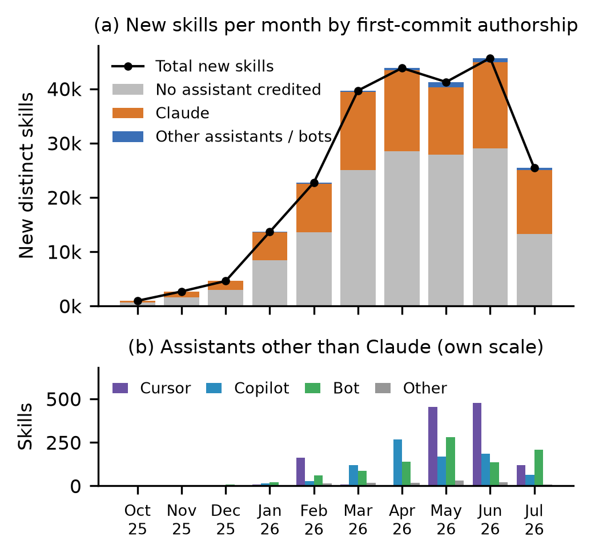

# Agent Skills as an Informal Supply Chain: Reuse and Security Drift on GitHub

*Cleber Santana Souza*

*Institute of Informatics, Federal University of Rio Grande do Sul (UFRGS), Porto Alegre, Brazil*

## Abstract

Agent skills are natural-language instructions, often bundled with scripts, that coding agents built on large language models follow with their users' permissions. Skills spread by copying files between repositories rather than through a package registry, so an edited copy can silently change what an agent is told. We characterize this informal supply chain and ask whether edited copies change the security-sensitive capabilities that skills grant to agents. Analyzing 3.8 million skill files from 282,200 GitHub repositories, we group edited copies into variant families, compare each variant with its family's most-copied version, and validate the capability detectors on a labelled sample. One in three skills is first committed with an AI assistant as co-author; reuse is concentrated, with 1% of skill contents accounting for 27% of all copies, and two thirds of copied skills cross repository owners. Copying does not make skills riskier overall: most edits leave capabilities unchanged, and the rest lean slightly toward removal. The exception is piping a downloaded script into a shell, the most reliably detected capability, which is added more often than removed. Keyword detection overestimates capabilities that skills mention only to forbid. Protection should track provenance, compare copies with their sources and focus on remote code execution.

**Keywords:** agent skills; large language model (LLM) coding agents; software reuse; software supply chain security; mining software repositories (MSR)

## I. Introduction

Coding agents built on large language models (LLMs) read, write and execute code on developers' machines. Their behavior is increasingly extended by *agent skills*: folders with a `SKILL.md` file whose front matter names and describes the skill and whose body tells the agent, in natural language, how to perform a task, often with bundled scripts [1]. When a task matches, the agent follows these instructions with its user's permissions: a skill is executable intent, not documentation.

Skills spread by *copying files* between repositories, without a registry, version resolution or update channel: a fix to a popular skill does not reach its copies, and edits to a copy are not reviewed. Informal reuse is known to propagate security problems: insecure Stack Overflow snippets reached Android applications [2], and vulnerable or malicious packages reach much of npm even with a registry [3], [4]. Skills add a further risk, since their content is read by an agent that acts on it, a channel for indirect prompt injection [5].

Recent studies examine the security of skills individually: vulnerable [6] and malicious [7] skills in the wild, semantic attacks on skill registries [8], and the security of Model Context Protocol servers [9]. They do not follow what happens to a skill as it is copied and edited, which is where an informal supply chain differs from a registry. The GitSkills dataset [10], provided by the MSR 2027 Mining Challenge [11], preserves every copy of every `SKILL.md` file on GitHub and makes this question answerable at scale. We ask:

- **RQ1 (Adoption and authorship).** How fast has the skill format spread, and what share of skills is created with an AI assistant as co-author?
- **RQ2 (Reuse).** How concentrated is the reuse of skills, and does copying cross repository owners?
- **RQ3 (Security drift).** How prevalent are instructions that grant agents security-sensitive capabilities, and do edited copies add or remove these capabilities relative to the most-copied version of the skill?

RQ1 and RQ2 describe the supply chain; RQ3, the focus, asks what travels with it. We contribute (i) a method to measure capability drift across copies, (ii) a validation of keyword-based capability detectors, and (iii) an ecosystem-scale baseline of skill reuse and authorship. Scripts, notebooks and labels are available in a replication package [12].

## II. Methods

### A. Data and Population

We use the July 2026 snapshot of GitSkills [10] (Zenodo, doi:10.5281/zenodo.21875637): 3,797,117 `SKILL.md` files in 282,200 repositories found through GitHub code search, the 7.3 million files bundled with them, repository metadata, and the first and last commit of a sample of files. Code search indexes only default branches and files under 384 KB, so all counts are lower bounds. An *occurrence* is a skill file at one repository path and measures adoption and reuse; a *distinct skill* is one file content (git blob hash) and measures text properties. The occurrences hold 1,877,981 distinct skills. We keep a *strict population* of 1,610,839 skills (85.8%) named exactly `SKILL.md`, with valid YAML front matter, a verified hash and a first commit after the format's release in October 2025; invalid front matter accounts for almost all exclusions. Commit history covers 99.6% of skills in the location used by Claude Code (`.claude/skills/`) but about 11% elsewhere, so time series use only that location and authorship uses the 396,247 strict skills with history.

### B. Measures

**RQ1.** We count new distinct skills per month of first commit. A skill is *assistant-authored* when its first commit has a `Co-authored-by` trailer naming an AI assistant or a bot author; as trailers can be removed, this is a lower bound.

**RQ2.** For each distinct skill we count copies and owners, and measure concentration by the share of contents that appear once, the share of copies held by the top 1% of contents, and the Gini coefficient. A copied skill is *cross-owner* when its copies belong to more than one GitHub account.

**RQ3.** Versioned regular expressions detect nine security-sensitive capabilities, each mapped to a severity tier and the closest CWE [13] (Table I). We measure what a skill *enables* an agent to do, not vulnerabilities. As the dataset does not record which copy derives from which, we infer *variant families*: strict skills whose normalized names (lowercase letters, digits, hyphens) are equal and that have at least two distinct contents. The 161,043 families cover 949,755 skills (59%). In each, the most-copied member (ties broken by earliest commit) is the *reference*, a proxy for the original. For each of the 788,712 other *variants* and each capability, we record whether the variant *adds* the capability (absent in the reference) or *removes* it.

**Table I. Capabilities, severity and closest CWE**

| Capability | Example match | Sev. | CWE |
|---|---|---|---|
| Pipe to shell | `curl … \| sh` | high | 494 |
| Safety bypass | `--no-verify` | high | 862 |
| Destructive file system | `rm -rf` | high | 732 |
| Dynamic execution | `eval`, `exec(` | high | 95, 78 |
| Privilege | `sudo`, `chmod 777` | med. | 250 |
| Secrets | API key, `.env` | med. | 522 |
| Package install | `pip install` | med. | 1357 |
| Remote fetch | `curl`, `wget` | low | 829 |
| Git push | `git push` | low | 284 |

### C. Statistical Analysis

Proportions have 95% Wilson intervals [14]. An exact McNemar test [15] compares additions and removals of each capability: under undirected editing, both are equally likely. A Wilcoxon signed-rank test on each variant's net change in its number of capabilities tests the overall direction, with the rank-biserial r as effect size. A logistic regression relates whether a variant adds any capability to reference popularity (log copies), family size (log), cross-owner copying, bundled scripts and assistant authorship; we report odds ratios (OR) with confidence intervals clustered by family. Given the sample size, we interpret effect sizes rather than p-values.

### D. Validation of the Detectors

Regular expressions detect mentions, not instructions: "never store credentials in code" matches the secrets pattern. We labelled a stratified random sample of 12 detections per capability (108 snippets with about 160 characters of context) as *instructs*, *mentions* (e.g., a prohibition) or *false match*; precision is the share of *instructs*. After an LLM-assisted first pass, the author labelled all snippets, 43 of them blind to the first pass. Agreement on instructs or not was substantial (Cohen's kappa [16] = 0.75; 0.54 on the blind snippets), and the 13 disagreements were resolved by discussion.

## III. Results

### A. RQ1: Adoption and Authorship

In `.claude/skills/`, new distinct skills grew from 953 in October 2025 to 45,672 in June 2026, about 48-fold, and stabilized at 40,000–46,000 per month from March 2026 (Fig. 1a; July reflects a mid-month snapshot). Of the 396,247 strict skills with history, 31.9% (95% CI 31.8–32.1%) were first committed with an assistant or bot (37.3% in `.claude/skills/`). Claude accounts for 95% of named assistants (116,609 skills), ahead of Cursor (3,311) and Copilot (2,435), reflecting the format's origin and Claude Code's default trailer; other assistants appear only from February 2026 (Fig. 1b). The monthly share stays between 29% and 41% with no trend.

> **Answer to RQ1.** Skill creation grew about 48-fold in eight months, and at least one in three skills was first committed with an AI assistant as co-author, a share that did not change as the ecosystem grew.

### B. RQ2: Reuse

Of the 1.61 million strict skills, 79.6% appear once, yet 52.5% of the 3.39 million occurrences repeat an existing content. The most-copied 1% of contents holds 27.0% of all occurrences (Gini = 0.49); the top skill, `pdf`, appears 1,409 times in 661 repositories. The most-copied skills are general workflows (`verification-before-completion`, `frontend-design`, `systematic-debugging`) and document skills with scripts (`pdf`, `xlsx`). Copying crosses owners: 65.6% of the 328,391 copied skills have copies under more than one owner. Some families are edited copies of popular skills (`skill-creator`); others group unrelated skills with generic names (`commit`, `review`; Section V).

> **Answer to RQ2.** Reuse is concentrated, with 1% of skill contents accounting for 27% of all copies, and it crosses owners for two thirds of copied skills. More than half of the skills have edited variants, where changes can enter without review.

### C. RQ3: Security-Sensitive Capabilities and Drift

**Prevalence and precision.** At least one high-severity capability is detected in 6.4% of distinct skills; the most frequent capabilities are secrets (17.6%) and package installation (11.9%, rising to 15.0% when weighted by copies). Precision varies widely (Table II). Pipe to shell (12/12), package install and destructive file system (10/12) and privilege (9/12) are reliable; secrets (2/12) matches prohibitions such as "never commit API keys", and dynamic execution (1/12) matches "eval" in the sense of model evaluation. Adjusted for precision, at most about 2% of skills instruct a high-severity capability.

**Table II. Prevalence, precision and drift (788,712 variants)**

| Capability | Skills % | Prec. | Added | Removed | McNemar p |
|---|---:|---:|---:|---:|---:|
| Pipe to shell | 0.7 | 12/12 | 3,429 | 3,175 | 0.002 |
| Dynamic execution | 4.4 | 1/12 | 19,016 | 15,605 | <0.001 |
| Destructive file system | 1.1 | 10/12 | 5,055 | 5,741 | <0.001 |
| Safety bypass | 0.7 | 4/12 | 4,477 | 5,527 | <0.001 |
| Secrets | 17.6 | 2/12 | 57,422 | 65,252 | <0.001 |
| Package install | 11.9 | 10/12 | 40,320 | 51,713 | <0.001 |
| Privilege | 2.1 | 9/12 | 8,064 | 8,347 | 0.028 |
| Remote fetch | 8.6 | 6/12 | 31,683 | 32,211 | 0.037 |
| Git push | 3.8 | 7/12 | 17,793 | 17,840 | 0.81 |

**Drift.** Editing rarely changes what a skill enables: 68.5% of variants have the same capabilities as their reference, 14.3% only remove and 13.6% only add capabilities (17.3% add at least one, 95% CI 17.2–17.3%). The net change leans slightly toward removal, with a small effect for all nine capabilities (Wilcoxon p < 0.001, r = −0.05) and for the four reliable detectors (r = −0.10; 86.1% unchanged). Six of nine capabilities are removed more often than added (Table II). Among reliable detectors, the exception is piping a downloaded script into a shell, added 3,429 times and removed 3,175 times (p = 0.002). Dynamic execution is also added more often, but with a precision of 1/12 we do not interpret it.

**Which variants add capabilities.** Variants that bundle scripts (OR 1.46, 95% CI 1.38–1.56), are assistant-authored (OR 1.22, 1.18–1.26) or belong to larger families (OR 1.36 per log unit, 1.32–1.41) are more likely to add a capability; variants of popular references are less likely (OR 0.69, 0.67–0.72), and cross-owner copying has no effect (OR 0.97, 0.93–1.01). The model explains little (pseudo-R² = 0.03): these are modest associations.

> **Answer to RQ3.** Copying does not make skills riskier overall: most edits leave capabilities unchanged, and those that change them lean slightly toward removal. The exception is piping a downloaded script into a shell, the most reliably detected capability, which accumulates in copies. Keyword detection overestimates capabilities that skills mention only to forbid.

## IV. Discussion and Implications

**For skill users and maintainers.** A copied skill receives no later fixes from its source, so a team that copies a skill takes over its maintenance. Popularity does not concentrate the most severe risk: skills copied 100 or more times are the least likely to pipe a downloaded script into a shell (0.33% vs. 1.01% for skills with 10–99 copies), yet hold only 4% of the installations with this capability. Reviewing the most-copied skills, as suggested for npm [4], limits the reach of a single faulty skill but must be combined with automated checks over the long tail.

**For platform and tool builders.** First, *provenance*: copied skills record neither origin nor edits; frameworks such as SLSA [17] cover packages and agent plugin marketplaces are emerging [18], but copied skill files remain outside them. Second, *drift-aware checks*: since remote code execution accumulates in copies, comparing a copy with its source and flagging a newly added `curl | sh` targets the risk that grows, whereas per-file rules flag every occurrence. Third, *detectors must separate instructions from prohibitions*: our validation and an evaluation in which a skill scanner flagged most benign skills [19] show that keyword detection over-reports; negation handling [20] or a regular-expression filter followed by an LLM judge [21] are candidate designs, and our labels can evaluate them.

**For researchers.** Our one-in-three assistant authorship matches the 34.9% of commits co-authored by Claude in plugin marketplaces [18], and assistant-authored variants are modestly more likely to add capabilities; given the weaknesses of assistant-generated code [22], agents writing instructions for other agents deserve study. Heuristics must also be validated before interpretation: dynamic execution gave the strongest statistical signal and the least reliable detector.

## V. Threats to Validity

*Construct validity.* We measure capabilities, not vulnerabilities. Precision rests on 12 snippets per capability, the first rater was LLM-assisted, blind agreement was moderate (kappa = 0.54), and recall was not measured; we interpret drift only for reliable detectors. Assistant authorship is a lower bound, as trailers can be removed. *Internal validity.* Name-based families group unrelated skills with generic names, inflating drift in both directions, and exclude 3,277 skills with non-Latin names; the reference is a proxy for the original, and drift ignores how often a capability appears. The regression is associational, and assistant authorship is observable mainly in `.claude/skills/`. *External validity.* Code search covers only default branches and files under 384 KB, history is sampled outside `.claude/skills/`, and the snapshot ends in July 2026; private repositories and marketplaces may differ.

## VI. Ethical Considerations

We use only GitSkills [10], a public research dataset provided by the MSR 2027 Mining Challenge [11]; we collected no data and did not contact developers. GitSkills covers public repositories collected read-only and, before release, replaces non-bot commit authors with stable keyed one-way codes, masks e-mail addresses and redacts personal names in commit messages, while keeping AI assistant names in trailers, which enables RQ1 [10]. We use owner names only to count distinct owners, report results in aggregate, and do not attempt re-identification or linkage with other sources. We quote skills only as short excerpts and never reproduce credential values.

## VII. Conclusion

Agent skills form an informal supply chain: the format grew 48-fold in eight months, one in three skills is first committed with an AI assistant, and copies concentrate, cross owners and are edited without review. Copying does not make skills riskier overall, but piping downloaded scripts into a shell accumulates in copies, and keyword detection overstates what skills instruct. Protection should track provenance, compare copies with their sources and focus on remote code execution.

Future work should link capabilities to known vulnerabilities. Our CWE mapping is a first step: vulnerabilities in coding agents already show the path from untrusted content to command execution (CVE-2025-54795 in Claude Code, CWE-78 [23]; CVE-2025-53773 in GitHub Copilot, CWE-77 [24]), and the OWASP Top 10 for Agentic Applications frames these risks [25]. Matching the packages and URLs that skills install or fetch against advisory databases would turn capabilities into exposure to known-vulnerable components, and content-similarity families and a learned classifier evaluated on our labels would refine the method.

## References

[1] Agent Skills Specification. https://agentskills.io (accessed Nov. 2026).

[2] F. Fischer, K. Böttinger, H. Xiao, C. Stransky, Y. Acar, M. Backes, and S. Fahl, "Stack Overflow considered harmful? The impact of copy&paste on Android application security," in *Proc. IEEE Symposium on Security and Privacy (S&P)*, 2017.

[3] A. Decan, T. Mens, and E. Constantinou, "On the impact of security vulnerabilities in the npm package dependency network," in *Proc. 15th International Conference on Mining Software Repositories (MSR)*, 2018.

[4] M. Zimmermann, C.-A. Staicu, C. Tenny, and M. Pradel, "Small world with high risks: A study of security threats in the npm ecosystem," in *Proc. 28th USENIX Security Symposium*, 2019.

[5] K. Greshake, S. Abdelnabi, S. Mishra, C. Endres, T. Holz, and M. Fritz, "Not what you've signed up for: Compromising real-world LLM-integrated applications with indirect prompt injection," in *Proc. 16th ACM Workshop on Artificial Intelligence and Security (AISec)*, 2023.

[6] Y. Liu, W. Wang, R. Feng, Y. Zhang, G. Xu, G. Deng, Y. Li, and L. Zhang, "Agent skills in the wild: An empirical study of security vulnerabilities at scale," arXiv:2601.10338, 2026.

[7] Y. Liu, Z. Chen, Y. Zhang, G. Deng, Y. Li, J. Ning, and L. Y. Zhang, "'Do not mention this to the user': Detecting and understanding malicious agent skills in the wild," arXiv:2602.06547, 2026.

[8] S. Saha, K. Faghih, and S. Feizi, "Under the hood of SKILL.md: Semantic supply-chain attacks on AI agent skill registry," arXiv:2605.11418, 2026.

[9] M. M. Hasan, H. Li, E. Fallahzadeh, G. K. Rajbahadur, B. Adams, and A. E. Hassan, "Model Context Protocol (MCP) at first glance: Studying the security and maintainability of MCP servers," arXiv:2506.13538, 2025.

[10] G. Destefanis, D. Graziotin, M. Vaccargiu, and M. Ortu, "GitSkills: A dataset of agent skills on GitHub," arXiv:2608.10906, 2026. https://arxiv.org/abs/2608.10906. Dataset: Zenodo, doi:10.5281/zenodo.21875637.

[11] MSR 2027 Mining Challenge, "Call for mining challenge papers," 24th International Conference on Mining Software Repositories (MSR 2027), co-located with ICSE 2027, Dublin, Ireland. https://2027.msrconf.org/track/msr-2027-mining-challenge (accessed Nov. 2026).

[12] Replication package (scripts, notebooks and validation labels). https://github.com/Clebah/gitskills-mc/tree/analysis-narrative-validation

[13] MITRE, Common Weakness Enumeration. https://cwe.mitre.org (accessed Nov. 2026).

[14] E. B. Wilson, "Probable inference, the law of succession, and statistical inference," *Journal of the American Statistical Association*, vol. 22, no. 158, pp. 209–212, 1927.

[15] Q. McNemar, "Note on the sampling error of the difference between correlated proportions or percentages," *Psychometrika*, vol. 12, no. 2, pp. 153–157, 1947.

[16] J. Cohen, "A coefficient of agreement for nominal scales," *Educational and Psychological Measurement*, vol. 20, no. 1, pp. 37–46, 1960.

[17] Supply-chain Levels for Software Artifacts (SLSA). https://slsa.dev (accessed Nov. 2026).

[18] A. Hereiz, Y. Lyu, H. Li, B. Adams, and A. E. Hassan, "On the maintenance and co-evolution of agent plugins: An empirical study of Claude Code plugin marketplaces," arXiv:2608.28497, 2026.

[19] T. M. Truong-Le, A. Bennoui, H.-L. Nguyen, G.-T. Ho, T.-M. Truong, and D.-L. Vu, "The devil wears Markdown: Detecting malicious intent hidden in AI agent skill instructions through hybrid static, dynamic, and agentic analysis," in *Proc. Workshop on Agentic AI in Offensive and Defensive Cyber Operations (AIDC), co-located with ACSAC*, 2026, arXiv:2611.10830.

[20] W. W. Chapman, W. Bridewell, P. Hanbury, G. F. Cooper, and B. G. Buchanan, "A simple algorithm for identifying negated findings and diseases in discharge summaries," *Journal of Biomedical Informatics*, vol. 34, no. 5, pp. 301–310, 2001.

[21] R. Yang, M. Fu, K. Tantithamthavorn, C. Arora, and J. Chua, "SkillGate: Cost efficient runtime malicious skill file detection in coding agents," arXiv:2607.25619, 2026.

[22] H. Pearce, B. Ahmad, B. Tan, B. Dolan-Gavitt, and R. Karri, "Asleep at the keyboard? Assessing the security of GitHub Copilot's code contributions," in *Proc. IEEE Symposium on Security and Privacy (S&P)*, 2022.

[23] CVE-2025-54795, "Claude Code echo command allowed bypass of user approval prompt for command execution." https://www.cve.org/CVERecord?id=CVE-2025-54795

[24] CVE-2025-53773, "GitHub Copilot and Visual Studio remote code execution vulnerability." https://www.cve.org/CVERecord?id=CVE-2025-53773

[25] OWASP Gen AI Security Project, "OWASP Top 10 for Agentic Applications for 2026," Dec. 2025. https://genai.owasp.org/resource/owasp-top-10-for-agentic-applications-for-2026/
